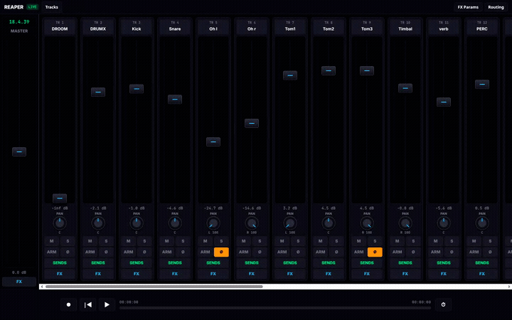

# REAPER Touch Console Pro

Controlador web táctil para REAPER. Cada usuario lo instala en su propio REAPER; este repositorio no aloja ni comparte sesiones de audio.

## Demostración

[Ver el video completo (20 s, sin audio)](mixer-tour.webm)

## Requisitos

- REAPER con Web Control disponible y habilitado.
- El script `FX_Control_Bridge.lua`, incluido en este repositorio.
- Un navegador moderno en el mismo equipo o en un dispositivo de la red local.

## Instalación

1. Descarga o clona este repositorio.
2. Copia la carpeta `mixer` a la carpeta `reaper_www_root` de tu instalación de REAPER. Debe quedar como `reaper_www_root/mixer/index.html`.
3. Copia `FX_Control_Bridge.lua` a la carpeta `Scripts` de REAPER.
4. En REAPER, abre **Actions > Show action list**, usa **ReaScript > Load**, selecciona `FX_Control_Bridge.lua` y ejecútalo.
5. Habilita **Web interface** en **Preferences > Control/OSC/web**. Abre en el navegador la dirección que aparece en esa configuración y agrega `/mixer/` al final.

La página usa `/main.js`, que lo proporciona el servidor Web Control de REAPER. Por eso, abrir `mixer/index.html` como archivo local o alojarlo por sí solo en GitHub Pages no conecta con REAPER.

## Acceso desde otro dispositivo

Para usar el controlador desde un teléfono o tableta en la misma red, habilita Web Control en REAPER y abre desde ese dispositivo la dirección LAN que muestra REAPER, seguida de `/mixer/`. El equipo con REAPER debe permanecer encendido y accesible en la red.

## Seguridad

Web Control puede accionar transporte, pistas, efectos y ruteo. No reenvíes su puerto al Internet público ni publiques una dirección de acceso a tu REAPER. Para acceso remoto, usa una VPN privada y comparte el código del controlador, no el acceso a tu sesión.